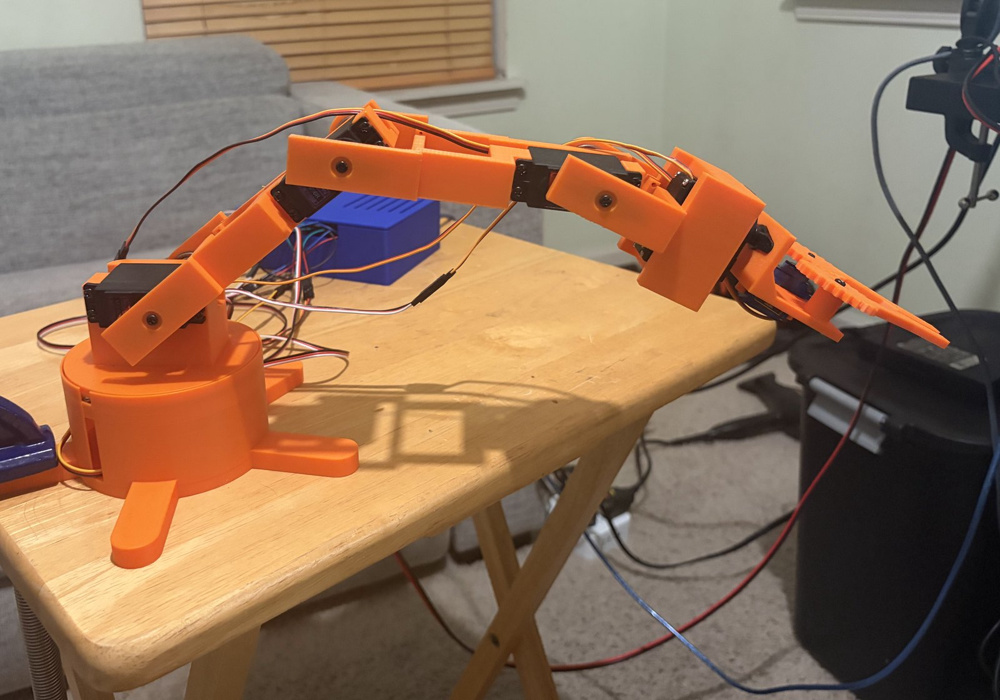
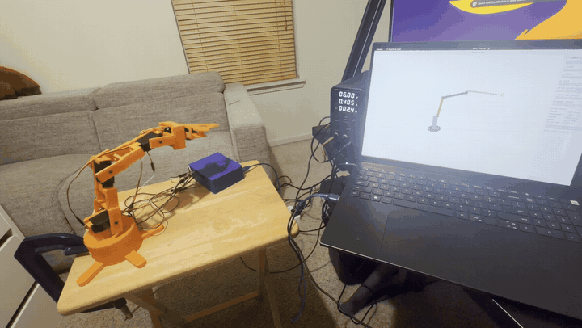
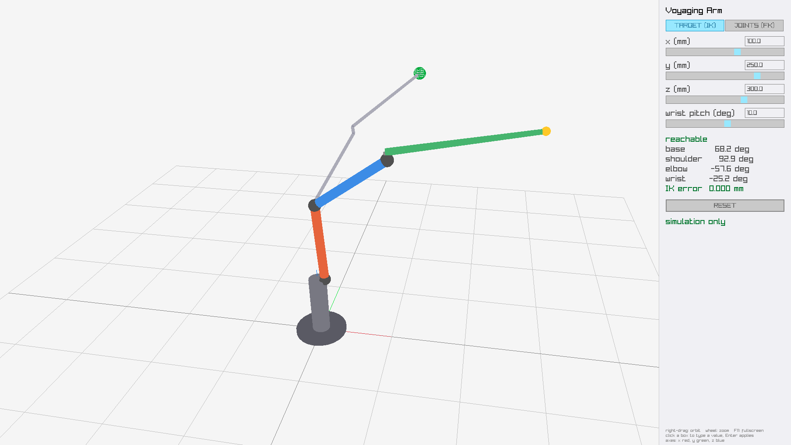
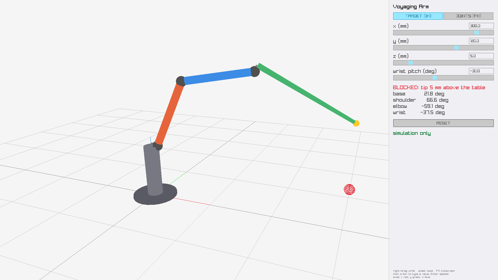
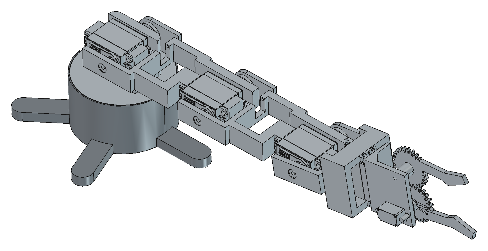
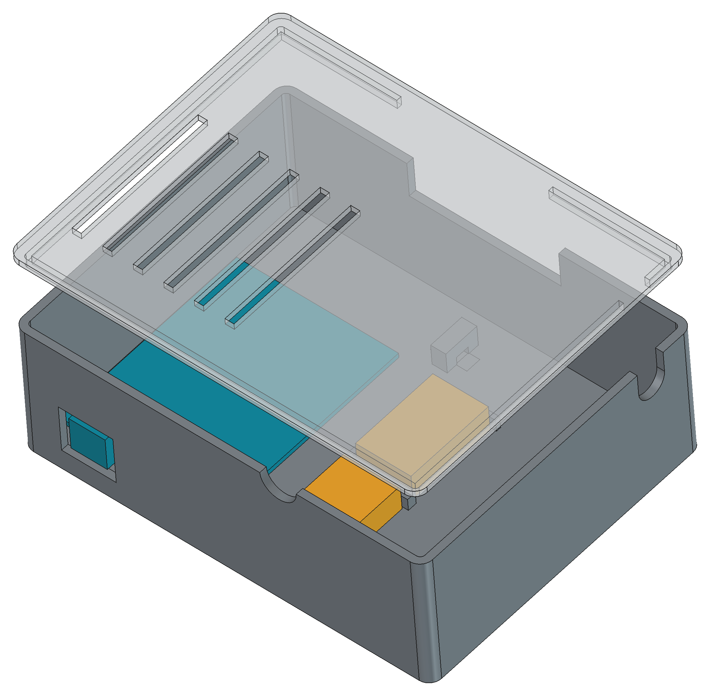

# Voyaging Arm

A 6 DOF robot arm I designed, printed, wired and programmed from scratch. A 3D simulation on the
host computer plans every move, checks it is safe, and streams the poses to the arm 50 times a
second over serial.

<p align="center">
  
</p>

<p align="center">
  
  <br><em>The simulation on the laptop driving the arm.</em>
</p>

## What it does

- Drive the arm by **tip position** (inverse kinematics) or by **joint angles** (forward kinematics)
  from a 3D simulation. The target pose shows as a ghost and the arm glides toward it.
  Wrist roll and gripper have their own sliders in both modes.
- The same program drives the physical arm: every frame's pose goes to an Arduino Uno over serial.
- Unsafe targets are refused: joints past their CAD collision limits or their servo's calibrated
  travel, or any joint or the tip closer than 10 mm to the table.
- Every in between step is checked too. Two safe poses can still have an unsafe one between them
  (swinging the claw through the table), so the arm holds still rather than take that step.
- Link lengths come straight from the CAD file, so the kinematics always match the arm as built.

<p align="center">
  
  
  <br><em>Left: the outline is the solved target pose and the arm is partway there. Right: a target too close to the table is refused and the arm holds its last safe pose.</em>
</p>

## Hardware

| Part | Details |
|---|---|
| Structure | Designed in FreeCAD, printed on FDM. Base, rotating turntable, two 110 mm links, wrist pitch, wrist roll, gear driven two jaw gripper. About 409 mm full reach. |
| Actuators | MG996R and SG90 hobby servos (no position feedback) |
| Controller | Arduino Uno, servos on pins 3, 5, 6, 9, 10, 11 (base, shoulder, elbow, wrist pitch, wrist roll, gripper) |
| Power | Dedicated 6V 10A supply on its own rail (Wago connectors), sized for stall current so the board doesn't brown out when several joints strain at once. Common ground with the Uno, signal wires routed away from the high current runs. |
| Enclosure | Printed box for the Arduino, connectors, wiring and power (`cad/cable-box`) |

<p align="center">
  
  
  <br><em>The FreeCAD assembly, built around the vendor servo models, and the cable box.</em>
</p>

## How it works

```
 FreeCAD model ──export_geometry.py──> geometry.hpp
                                           │
 simulation (raylib) ── IK / FK ── limits + path check ── servo calibration ── serial 50 Hz ──> Arduino ──> servos
```

**Firmware** (`firmware/`, PlatformIO). A line based serial protocol at 115200 baud:

```
P <base> <shoulder> <elbow> <wrist> <roll> <gripper>   set servo commands in degrees, "-" leaves one alone
R                                                     release every servo (goes limp)
R <0..5>                                              release one servo
```

Commands are clamped to 0 to 180, bad lines get an `ERR <reason>` reply, and the loop only reads
what has already arrived, so it never blocks waiting on the host. Servos stay unpowered until
their first command so nothing jumps at power on, and the board prints `READY` after its reset so
the host knows when it can send.

**Kinematics** (`host/src/kinematics.cpp`). Base yaw plus a planar shoulder, elbow, wrist chain,
including the shoulder and wrist offsets from the CAD. Inverse kinematics solves base yaw first
from the target's x and y, then the shoulder and elbow as a two link problem in the arm's vertical
plane, then the wrist from the requested pitch. It picks elbow up, and falls back to elbow down
when elbow up is outside the limits.

**Joint limits** (`host/include/arm/limits.hpp`). Found by sweeping each joint in the CAD until
parts collide, then backing off a 5 degree margin. Both programs then narrow them to what each
servo reaches as calibrated, so the simulation never shows a pose the servo would stop short of.

**Motion** (`host/src/motion.cpp`). Every joint moves toward its target at no more than 90 deg/s,
below the MG996R's top speed. Each step is safety checked before it is sent.

**Calibration** (`host/src/calibrate.cpp`). Hobby servos have no position feedback, so a person does
the looking. An interactive terminal tool steps each servo with the arrow keys; you mark the
command at two measured poses, and the line through those two points gives the servo's offset,
direction (mirrored servos) and scale. Results are saved to `host/calibration/servos.txt`.

## Build and run

Host code is C++20 with CMake and runs on Linux (the serial link uses POSIX). raylib, raygui and
GoogleTest are fetched automatically.

```bash
# host
cmake -S host -B build
cmake --build build
ctest --test-dir build                   # unit tests

./build/arm_simulation                   # simulation only, no hardware needed
./build/arm_calibrate /dev/ttyACM0       # calibrate each servo once
./build/arm /dev/ttyACM0                 # drive the arm from the simulation

# firmware
cd firmware && pio run -t upload

# after changing the CAD
python3 tools/export_geometry.py
```

## Tests

29 GoogleTest unit tests across kinematics (forward and inverse agree, known poses), joint limits
and the ground check, rate limited motion, and servo mapping, servo travel and calibration file parsing.

## Repo layout

```
cad/        FreeCAD models (arm, cable box), STL exports, vendor servo models
firmware/   Arduino Uno firmware (PlatformIO)
host/       kinematics, limits, motion, serial link, calibration tool, simulation, tests
tools/      CAD to C++ geometry export
```

## Limitations and next steps

- **No position feedback.** The servos don't report where they are, so accuracy depends on
  calibration, and positioning is still slightly off. Next: IMUs on the links to measure the actual
  link angles, which would also catch gear slop and sag that the servo itself can't see.
- **No hardware e-stop.** The hardware stop today is the switch on the servo supply. The servos go
  limp when power is cut, so a proper stop would need a controlled hold, not just cutting power.
- **Simple motion.** Joints move at a capped speed toward the target. No smooth acceleration
  profiles or straight line tip paths yet.
